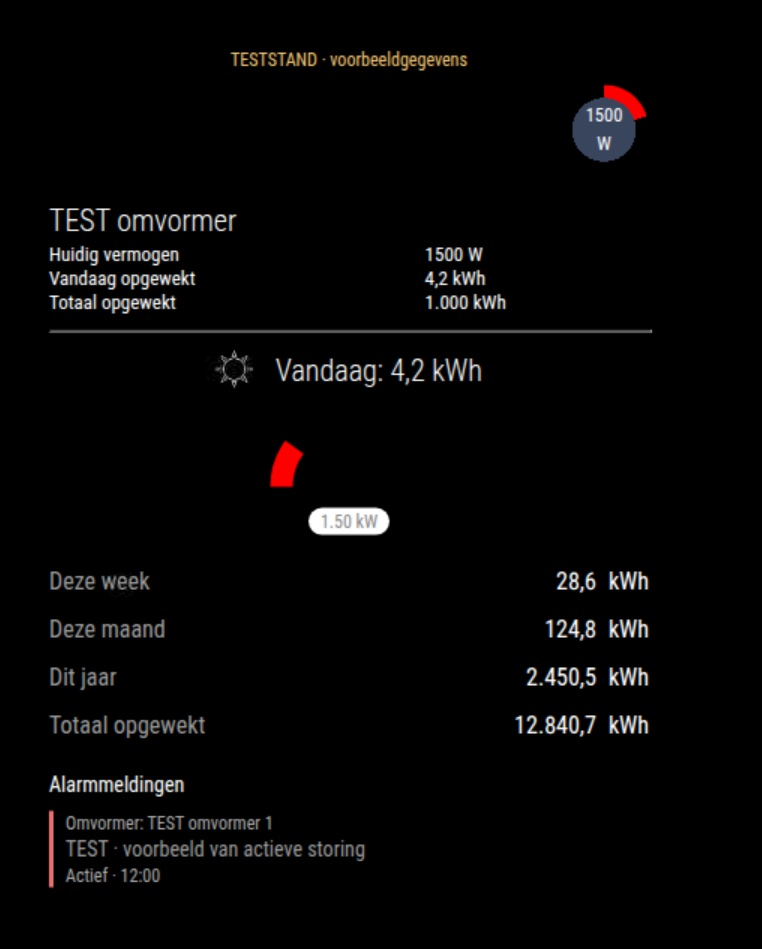

# MMM-Goodwe-SemsPortal-V3

A MagicMirror² module for monitoring a GoodWe solar installation through SEMS+.

**Version: V3.0.5**

## Features

- Current solar power and daily energy production.
- Weekly, monthly, yearly and lifetime energy totals.
- Individual inverter information.
- Circular and semicircular power gauges.
- Alarm display with inverter identification when available.
- English, Dutch, German and French interface translations.
- Server-side login using a separate credentials file.

## Screenshot



*Screenshot from a Raspberry Pi showing demonstration data.*

## Requirements

- A working [MagicMirror²](https://github.com/MagicMirrorOrg/MagicMirror) installation.
- Node.js 22 or later.
- A GoodWe SEMS account and the power station ID for the installation.

No additional npm packages are required by this module.

## Installation

Run the following commands from the MagicMirror modules directory:

```bash
cd ~/MagicMirror/modules
git clone https://github.com/smartthinks/MMM-Goodwe-SemsPortal-V3.git
```

## Account setup

Account credentials are stored separately from the MagicMirror display configuration. The module reads them on the server; they are not sent to the display.

### Create the credentials file

Run these commands as the same operating-system user that runs MagicMirror:

```bash
mkdir -p ~/.config/magicmirror
chmod 700 ~/.config/magicmirror
(umask 077; touch ~/.config/magicmirror/goodwe.json)
chmod 600 ~/.config/magicmirror/goodwe.json
nano ~/.config/magicmirror/goodwe.json
```

Add the following JSON and replace all three placeholder values:

```json
{
  "username": "YOUR_GOODWE_EMAIL",
  "password": "YOUR_GOODWE_PASSWORD",
  "powerstationId": "YOUR_POWERSTATION_ID"
}
```

Use the email address and password for the SEMS account. Enter the password as plain text; the module performs the processing required for authentication.

The power station ID identifies the installation in SEMS. When upgrading from an earlier version, copy the existing `powerstationId` from the module configuration.

Save the file. In nano, press **Ctrl+O**, then **Enter**, followed by **Ctrl+X**.

The file format is also available in [credentials.example.json](credentials.example.json).

Keep the credentials file outside the module directory and outside GitHub. Its contents are protected by file permissions, not encryption. The default path is relative to the home directory of the user running MagicMirror. A service running as another user will use that user's home directory.

### Configure MagicMirror

```js
{
  module: "MMM-Goodwe-SemsPortal-V3",
  position: "bottom_right",
  config: {
    totalCapacity: 5600,
    updateIntervalMinutes: 5,
    showInverterGauges: true,
    inverterGaugeStyle: "circle",
    showBottomTotalGauge: true,
    totalGaugeStyle: "semicircle",
    showInterverDetail: true,
    enableCustomGaugeColors: false,
    showEnergyTotals: true,
    showWeekYield: true,
    showMonthYield: true,
    showYearYield: true,
    showLifetimeYield: true,
    showAlarms: true,
    showResolvedAlarms: false,
    alarmLimit: 3
  }
},
```

Set `totalCapacity` to the combined rated inverter capacity in watts.

Do not include `username`, `password` or `powerstationId` in this configuration block. These values belong in the separate credentials file.

Restart MagicMirror after saving the credentials and configuration.

### Environment variables

As an alternative to file-based credentials, set the following environment variables for the MagicMirror process:

| Variable | Purpose |
| --- | --- |
| `GOODWE_USERNAME` | SEMS account email address. |
| `GOODWE_PASSWORD` | SEMS account password. |
| `GOODWE_POWERSTATION_ID` | Power station ID. |
| `GOODWE_CREDENTIALS_FILE` | Optional alternative credentials file path. |

When using environment-based login, both `GOODWE_USERNAME` and `GOODWE_PASSWORD` must be present. Set `GOODWE_POWERSTATION_ID` for the installation as well.

With file-based login, `GOODWE_POWERSTATION_ID` can override the station ID in the file. Environment variables must be available to the process that starts MagicMirror, including any service or process manager.

## Configuration options

| Option | Description |
| --- | --- |
| `totalCapacity` | Combined rated inverter capacity in watts. Default: `5600`. |
| `updateIntervalMinutes` | Solar data refresh interval in minutes. Values of at least `1` override the default five-minute interval. |
| `basicHeader` | Show the module header. Default: `false`. |
| `showInverterGauges` | Show individual inverter gauges. Set explicitly to `true` or `false`. |
| `inverterGaugeStyle` | Individual gauge style: `"circle"` or `"semicircle"`. Default: `"circle"`. |
| `showBottomTotalGauge` | Show the combined power gauge. Set explicitly to `true` or `false`. |
| `totalGaugeStyle` | Combined gauge style: `"circle"` or `"semicircle"`. Default: `"circle"`. |
| `showInterverDetail` | Show inverter detail fields. The existing option spelling is retained for compatibility. |
| `enableCustomGaugeColors` | Enable colors supplied through `customGaugeColors`. |
| `showEnergyTotals` | Show the energy totals overview. Default: `true`. |
| `showWeekYield` | Show weekly energy production. Default: `true`. |
| `showMonthYield` | Show monthly energy production. Default: `true`. |
| `showYearYield` | Show yearly energy production. Default: `true`. |
| `showLifetimeYield` | Show lifetime energy production. Default: `true`. |
| `showAlarms` | Retrieve and display alarms. Default: `true`. |
| `showResolvedAlarms` | Include resolved alarms. Default: `false`. |
| `alarmLimit` | Maximum displayed alarms, from `1` to `15`. Default: `3`. |
| `debugEnergy` | Log energy counter diagnostics on the server. Default: `false`. Enable temporarily for troubleshooting. |

### Custom gauge colors

Add this object inside the module's `config` object and set `enableCustomGaugeColors: true`:

```js
customGaugeColors: {
  innerCircleColor: "#3a455e",
  outerCircleColor: "transparent",
  currentValueRingColor: "#1abc9c"
}
```

### Inverter detail fields

Use `goodwe-options.json` to enable or disable optional detail fields by changing their `enabled` values. Restart MagicMirror after editing the file.

Keep the three `main` fields in their original order: current power, daily energy and lifetime energy. Unavailable measurements are displayed as `—`.

## Languages

The module follows the global MagicMirror `language` setting:

| Language | Code |
| --- | --- |
| English | `en` |
| Dutch | `nl` |
| German | `de` |
| French | `fr` |

Other languages fall back to English. Number formatting follows the selected language.

## Energy totals

Energy counters are normalized to kWh. The daily summary shows Wh below 1 kWh; other energy fields show kWh. The module uses the SEMS+ period counters for today, this week, this month, this year and lifetime production.

Each period is requested separately with the SEMS+ `groups` selection. This fixes the `A0400` errors caused by requests without an explicit period selection. Daily yield and current power are refreshed on the configured interval. Week, month, year and lifetime counters are reused for up to 15 minutes, then refreshed. Cached periods are also invalidated when the server's local or UTC calendar date changes. GoodWe determines the actual period boundaries. On a full refresh there are five energy counter requests per inverter; cached refreshes request only daily yield, in addition to telemetry and device discovery. A failed period request does not discard other available periods.

Period boundaries are determined by GoodWe. Weekly, monthly and yearly values are calendar-period counters, rather than rolling 7-, 30- or 365-day totals.

If a required counter is unavailable for an inverter, the corresponding combined total is displayed as `—` instead of a partial sum.

### Request pacing and startup

Requests made by this module, including login and alarms, share a queue with at least two seconds between the completion of one request and the start of the next. With three inverters, a full solar refresh makes 19 requests and a refresh with cached period counters makes 7, excluding login and alarms.

HTTP 429 or API code `GY0429` stops the current solar refresh. The module waits at least five minutes, or longer if the server supplies a longer `Retry-After`. Previous display values are retained with an error notice and may be out of date. The queue coordinates only this module; other applications using the account may still contribute to rate limits.

The cache and cooldown are held in memory. Restarting clears them, so avoid repeated restarts when investigating a rate limit.

The overview appears immediately with placeholders and a translated waiting notice above the daily yield separator. The notice disappears after the first solar response. The first full round with three inverters typically takes about 45 seconds, depending on server response times. The overview uses a consistent 320-pixel width, constrained by its container, so placeholders and received values do not change its width. Existing MagicMirror zoom settings still apply.

## Alarms

Alarms are refreshed after login and then every five minutes, independently of the solar data refresh interval.

The alarm section is hidden when no matching alarms are returned. Resolved alarms are hidden by default; set `showResolvedAlarms: true` to include them. Alarms with an unknown status remain visible and are labelled accordingly.

An inverter name or serial number is displayed when provided by GoodWe. Otherwise, the module shows an unknown-inverter label.

The request retrieves up to 15 results from the first page for a 90-day period, using the SEMS+ API selections `status: 1` and `timeType: 1`. Results depend on the account and the GoodWe service; an empty response does not establish that no faults exist.

Interface labels follow the MagicMirror language. Alarm descriptions are supplied by GoodWe and may fall back to English or the general description.

If a refresh fails while earlier alarms are displayed, those alarms may remain visible with a stale-data notice.

## Updating

Back up the module directory and MagicMirror configuration before updating. Preserve any local changes to `goodwe-options.json`.

```bash
cd ~/MagicMirror/modules/MMM-Goodwe-SemsPortal-V3
git pull --ff-only
```

Restart MagicMirror after updating.

Version V3.0.5 adds request pacing, cached period counters, rate-limit handling and a consistent waiting/display layout with four-language waiting text.

Version V3.0.4 restores energy counters using explicit SEMS+ period selections and adds optional energy diagnostics. The internal daily yield field now uses the SEMS+ name `proPvStatsToday`.

Version V3.0.3 removed the built-in demonstration mode. The module always uses live SEMS+ data. Remove any old `testMode` option from your configuration; it no longer has an effect.

### Migrating from an earlier login configuration

1. Copy `username`, `password` and `powerstationId` into the separate credentials file described under [Account setup](#account-setup).
2. Remove those fields from the module entry in `config/config.js`.
3. Keep the module name `MMM-Goodwe-SemsPortal-V3`.
4. Restart MagicMirror.

Usernames and passwords in `config/config.js` are no longer used for login. An existing `powerstationId` there is supported as a fallback, but the separate credentials file takes priority.

## Troubleshooting

| Message or symptom | Check |
| --- | --- |
| Credentials error | Confirm that the credentials file contains valid JSON, includes a username and password, and is readable by the user running MagicMirror. |
| Missing configuration | Check that the power station ID is present in the credentials file or environment. |
| Connection error | Check network access, account details and availability of the GoodWe service. Node.js 22 or later is required. |
| Missing energy values | Enable `debugEnergy` as described below. `A0400` indicates a rejected request; update to V3.0.4 for explicit period selections. Some counters may still be unavailable for particular inverters. |
| Module does not load | Check that the folder, main JavaScript file and configured module name all use `MMM-Goodwe-SemsPortal-V3`. |

### Energy diagnostics

To investigate missing energy values, add this setting inside the module's `config` object:

```js
debugEnergy: true,
```

Restart MagicMirror. The server log will contain JSON entries prefixed with `[GoodWe][ENERGY]`, one per period and inverter on each refresh. Each entry includes a UTC timestamp, inverter index, period group, available HTTP and API status, received counter value and unit, normalized kWh value, and a diagnostic reason. `source: "cache"` and `ageSeconds` identify reused counters; these entries do not have HTTP/API status because no new request was made.

| Reason | Meaning |
| --- | --- |
| `ok` | The counter was converted successfully, including a valid zero. |
| `missing_factor` | The expected counter was absent. |
| `missing_data` | The counter had no measurement. |
| `invalid_value_or_unit` | The value or unit was rejected by the conversion. |
| `request_failed` | The request failed; inspect the available status fields. |
| `timeout` | The request timed out. |
| `rate_limited` | SEMS limited requests; `retryAt` gives the cooldown deadline in UTC. |
| `invalid_response_shape` | The response structure was not recognized. |

HTTP 200 alone does not indicate API success. The API code must also be successful (`00000` or `0`). Status fields may be absent if no response was received.

The diagnostic entries include only the selected energy counters, not credentials, request headers, complete API responses, station IDs or device serial numbers. Logging reuses normal requests and makes no extra API calls.

With PM2, read the output log for your MagicMirror process. For a process named `mm` using the default PM2 log location:

```bash
grep -aF '[GoodWe][ENERGY]' ~/.pm2/logs/mm-out.log | tail -n 15
```

Other process names or custom PM2 settings may use a different log file. Compare the logged values with the SEMS+ portal at the same time. After troubleshooting, remove `debugEnergy` or set it to `false`, then restart MagicMirror.

## License and acknowledgements

Released under the [MIT License](LICENSE).

The SEMS+ energy counter field names also appear in [MMM-GoodWe](https://github.com/marcovanwoudenberg/MMM-GoodWe). Dashboard and login code from that project has not been incorporated.
