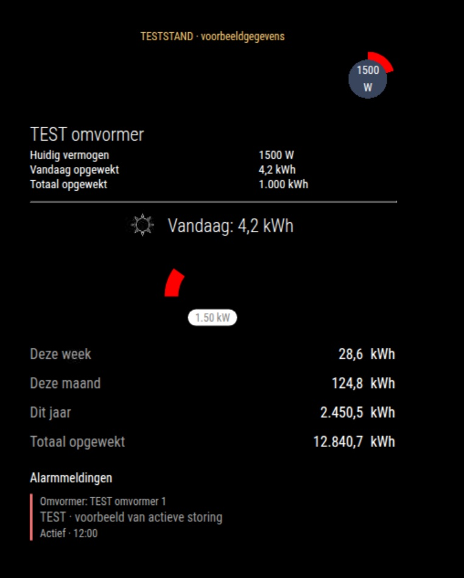

# MMM-Goodwe-SemsPortal-V3

A MagicMirror² module for monitoring a GoodWe solar installation through SEMS+.

**Version: V3.0.2**

## Features

- Current solar power and daily energy production.
- Weekly, monthly, yearly and lifetime energy totals.
- Individual inverter information.
- Circular and semicircular power gauges.
- Alarm display with inverter identification when available.
- English, Dutch, German and French interface translations.
- Server-side login using a separate credentials file.

## Screenshot



*Screenshot from a Raspberry Pi showing demonstration data.*

## Requirements

- A working [MagicMirror²](https://github.com/MagicMirrorOrg/MagicMirror) installation.
- Node.js 22 or later.
- A GoodWe SEMS account and the power station ID for the installation.

No additional npm packages are required by this module.

## Installation

Run the following commands from the MagicMirror modules directory:

```bash
cd ~/MagicMirror/modules
git clone https://github.com/smartthinks/MMM-Goodwe-SemsPortal-V3.git
```

## Account setup

Account credentials are stored separately from the MagicMirror display configuration. The module reads them on the server; they are not sent to the display.

### Create the credentials file

Run these commands as the same operating-system user that runs MagicMirror:

```bash
mkdir -p ~/.config/magicmirror
chmod 700 ~/.config/magicmirror
(umask 077; touch ~/.config/magicmirror/goodwe.json)
chmod 600 ~/.config/magicmirror/goodwe.json
nano ~/.config/magicmirror/goodwe.json
```

Add the following JSON and replace all three placeholder values:

```json
{
  "username": "YOUR_GOODWE_EMAIL",
  "password": "YOUR_GOODWE_PASSWORD",
  "powerstationId": "YOUR_POWERSTATION_ID"
}
```

Use the email address and password for the SEMS account. Enter the password as plain text; the module performs the processing required for authentication.

The power station ID identifies the installation in SEMS. When upgrading from an earlier version, copy the existing `powerstationId` from the module configuration.

Save the file. In nano, press **Ctrl+O**, then **Enter**, followed by **Ctrl+X**.

The file format is also available in [credentials.example.json](credentials.example.json).

Keep the credentials file outside the module directory and outside GitHub. Its contents are protected by file permissions, not encryption. The default path is relative to the home directory of the user running MagicMirror. A service running as another user will use that user's home directory.

### Configure MagicMirror

```js
{
  module: "MMM-Goodwe-SemsPortal-V3",
  position: "bottom_right",
  config: {
    totalCapacity: 5600,
    updateIntervalMinutes: 5,
    showInverterGauges: true,
    inverterGaugeStyle: "circle",
    showBottomTotalGauge: true,
    totalGaugeStyle: "semicircle",
    showInterverDetail: true,
    enableCustomGaugeColors: false,
    showEnergyTotals: true,
    showWeekYield: true,
    showMonthYield: true,
    showYearYield: true,
    showLifetimeYield: true,
    showAlarms: true,
    showResolvedAlarms: false,
    alarmLimit: 3
  }
},
```

Set `totalCapacity` to the combined rated inverter capacity in watts.

Do not include `username`, `password` or `powerstationId` in this configuration block. These values belong in the separate credentials file.

Restart MagicMirror after saving the credentials and configuration.

### Environment variables

As an alternative to file-based credentials, set the following environment variables for the MagicMirror process:

| Variable | Purpose |
| --- | --- |
| `GOODWE_USERNAME` | SEMS account email address. |
| `GOODWE_PASSWORD` | SEMS account password. |
| `GOODWE_POWERSTATION_ID` | Power station ID. |
| `GOODWE_CREDENTIALS_FILE` | Optional alternative credentials file path. |

When using environment-based login, both `GOODWE_USERNAME` and `GOODWE_PASSWORD` must be present. Set `GOODWE_POWERSTATION_ID` for the installation as well.

With file-based login, `GOODWE_POWERSTATION_ID` can override the station ID in the file. Environment variables must be available to the process that starts MagicMirror, including any service or process manager.

## Configuration options

| Option | Description |
| --- | --- |
| `totalCapacity` | Combined rated inverter capacity in watts. Default: `5600`. |
| `updateIntervalMinutes` | Solar data refresh interval in minutes. Values of at least `1` override the default five-minute interval. |
| `basicHeader` | Show the module header. Default: `false`. |
| `showInverterGauges` | Show individual inverter gauges. Set explicitly to `true` or `false`. |
| `inverterGaugeStyle` | Individual gauge style: `"circle"` or `"semicircle"`. Default: `"circle"`. |
| `showBottomTotalGauge` | Show the combined power gauge. Set explicitly to `true` or `false`. |
| `totalGaugeStyle` | Combined gauge style: `"circle"` or `"semicircle"`. Default: `"circle"`. |
| `showInterverDetail` | Show inverter detail fields. The existing option spelling is retained for compatibility. |
| `enableCustomGaugeColors` | Enable colors supplied through `customGaugeColors`. |
| `showEnergyTotals` | Show the energy totals overview. Default: `true`. |
| `showWeekYield` | Show weekly energy production. Default: `true`. |
| `showMonthYield` | Show monthly energy production. Default: `true`. |
| `showYearYield` | Show yearly energy production. Default: `true`. |
| `showLifetimeYield` | Show lifetime energy production. Default: `true`. |
| `showAlarms` | Retrieve and display alarms. Default: `true`. |
| `showResolvedAlarms` | Include resolved alarms. Default: `false`. |
| `alarmLimit` | Maximum displayed alarms, from `1` to `15`. Default: `3`. |

### Custom gauge colors

Add this object inside the module's `config` object and set `enableCustomGaugeColors: true`:

```js
customGaugeColors: {
  innerCircleColor: "#3a455e",
  outerCircleColor: "transparent",
  currentValueRingColor: "#1abc9c"
}
```

### Inverter detail fields

Use `goodwe-options.json` to enable or disable optional detail fields by changing their `enabled` values. Restart MagicMirror after editing the file.

Keep the three `main` fields in their original order: current power, daily energy and lifetime energy. Unavailable measurements are displayed as `—`.

## Languages

The module follows the global MagicMirror `language` setting:

| Language | Code |
| --- | --- |
| English | `en` |
| Dutch | `nl` |
| German | `de` |
| French | `fr` |

Other languages fall back to English. Number formatting follows the selected language.

## Energy totals

Energy values are shown in kWh. The module uses the SEMS+ period counters for today, this week, this month, this year and lifetime production.

Period boundaries are determined by GoodWe. Weekly, monthly and yearly values are calendar-period counters, rather than rolling 7-, 30- or 365-day totals.

If a required counter is unavailable for an inverter, the corresponding combined total is displayed as `—` instead of a partial sum.

## Alarms

Alarms are refreshed after login and then every five minutes, independently of the solar data refresh interval.

The alarm section is hidden when no matching alarms are returned. Resolved alarms are hidden by default; set `showResolvedAlarms: true` to include them. Alarms with an unknown status remain visible and are labelled accordingly.

An inverter name or serial number is displayed when provided by GoodWe. Otherwise, the module shows an unknown-inverter label.

The request retrieves up to 15 results from the first page for a 90-day period, using the SEMS+ API selections `status: 1` and `timeType: 1`. Results depend on the account and the GoodWe service; an empty response does not establish that no faults exist.

Interface labels follow the MagicMirror language. Alarm descriptions are supplied by GoodWe and may fall back to English or the general description.

If a refresh fails while earlier alarms are displayed, those alarms may remain visible with a stale-data notice.

## Updating

Back up the module directory and MagicMirror configuration before updating. Preserve any local changes to `goodwe-options.json`.

```bash
cd ~/MagicMirror/modules/MMM-Goodwe-SemsPortal-V3
git pull --ff-only
```

Restart MagicMirror after updating.

### Migrating from an earlier login configuration

1. Copy `username`, `password` and `powerstationId` into the separate credentials file described under [Account setup](#account-setup).
2. Remove those fields from the module entry in `config/config.js`.
3. Keep the module name `MMM-Goodwe-SemsPortal-V3`.
4. Restart MagicMirror.

Usernames and passwords in `config/config.js` are no longer used for login. An existing `powerstationId` there is supported as a fallback, but the separate credentials file takes priority.

## Troubleshooting

| Message or symptom | Check |
| --- | --- |
| Credentials error | Confirm that the credentials file contains valid JSON, includes a username and password, and is readable by the user running MagicMirror. |
| Missing configuration | Check that the power station ID is present in the credentials file or environment. |
| Connection error | Check network access, account details and availability of the GoodWe service. Node.js 22 or later is required. |
| Missing energy values | The relevant counters may not be available from SEMS for every inverter. |
| Module does not load | Check that the folder, main JavaScript file and configured module name all use `MMM-Goodwe-SemsPortal-V3`. |

## License and acknowledgements

Released under the [MIT License](LICENSE).

The SEMS+ energy counter field names also appear in [MMM-GoodWe](https://github.com/marcovanwoudenberg/MMM-GoodWe). Dashboard and login code from that project has not been incorporated.
